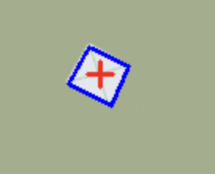
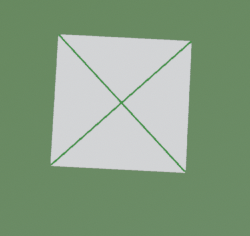
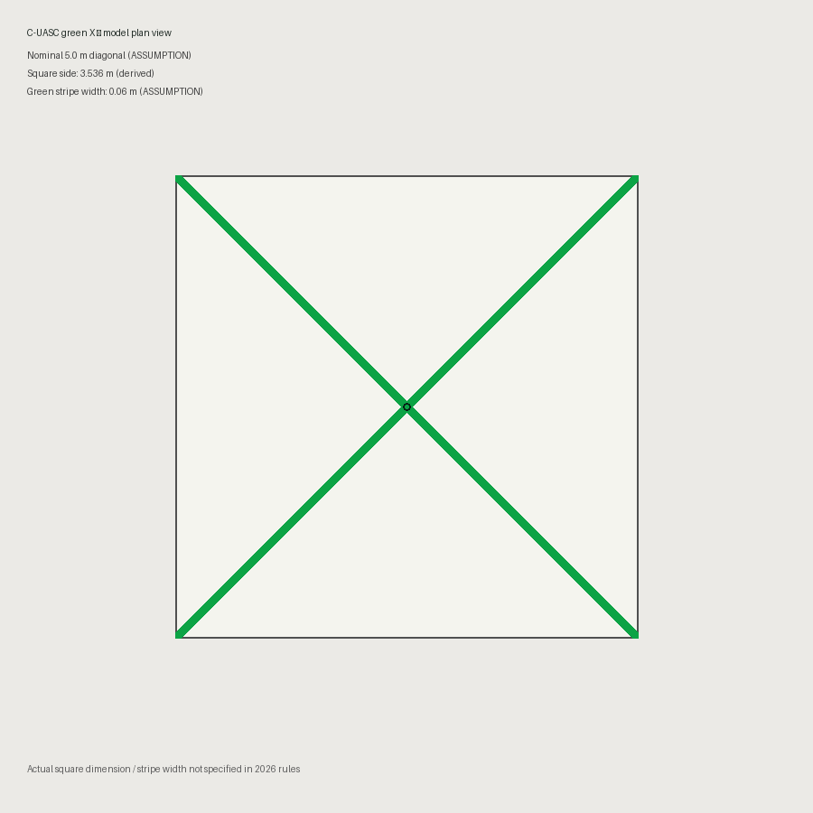

## Aerial Target Localization: Finding the Green X

I'm building a vision system that finds the center of the package-recovery
marker for the [C-UASC 2026](https://www.calstatela.edu/ecst/c-uasc) drone
competition: a white square with a green X, seen from the air.



*A synthetic aerial frame. Blue is the detected square, red is the predicted center.*

## Why I built this
The drone vision requires identifying a green X marker midflight for package retrieval. So in this project, I wanted to train a model that learns from a 2D probability heatmap to detect the X. My previous model training focused only on numerical data, so incorporating the generated visuals from Blender was a learning experience.

## How it works

1. **Synthetic data.** I modeled the target in Blender and rendered aerial
   frames with random camera angle, altitude, and lighting. Blender knows where the true center is, so every
   frame comes with a free label.
2. **Find the white square.** The detector locates the square's four corners
   and takes the point where its diagonals cross as the center.
3. **Check for the green X.** It flattens the square to a top-down view and
   looks for green along both diagonals, to reject white squares that aren't
   the target.

 

*The flattened square and the green found along its diagonals.*

## Results

I tested across 200 synthetic 256×256 frames, 57 of them with the center covered.

| Detector | Targets found | Mean center error |
|---|---|---|
| White square only | 197 / 200 | 1.52 px |
| White square + strict green check | 187 / 200 | 1.51 px |
| White square + tuned green check | 196 / 200 | 1.53 px |

The largest error on any detected frame was 3.1 px.

## Lessons learned
- Diagnose why detections fail before tuning thresholds via `vision/diagnose_misses.py` 
- Co-analyze color segmentation and geometry for more reliable localization
- Evaluate performance under occlusion and varying camera angles

## Upcoming improvements
- Add frames with no target, so the system can report "not present"
- Train a CNN heatmap model in `vision/train.py` and compare it with the
  detector above on the same 200 frames
- Evaluate performances on real drone photos
## Run it

```bash
pip install -r requirements.txt
python vision/baseline_v2.py output_test/dataset/images/frame_00000.png --verify-green
python vision/evaluate.py --dataset output_test/dataset
```

Full setup, including generating the dataset in Blender, is in
[SETUP.md](SETUP.md) and [QUICKSTART.md](QUICKSTART.md).

## The target



The rules give a marker of about 5 m with a green X on white, but not the
exact side length or stripe width. Those are my assumptions and are recorded
in `model/spec.json`.